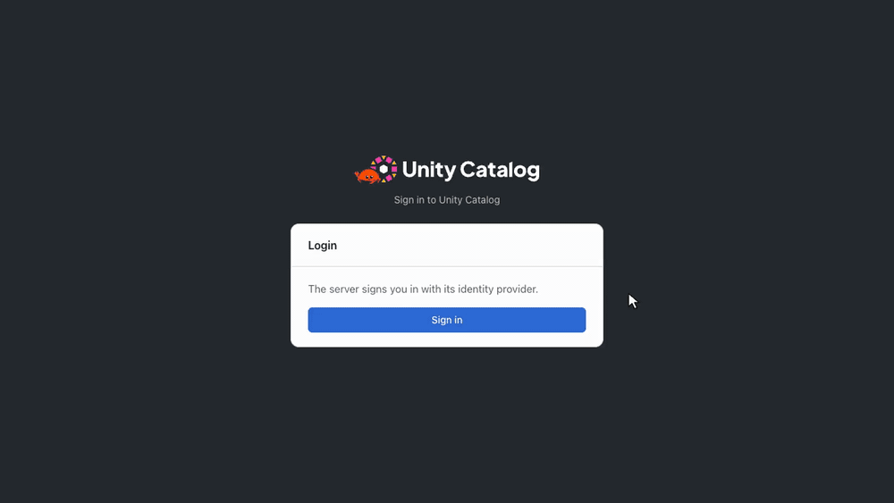
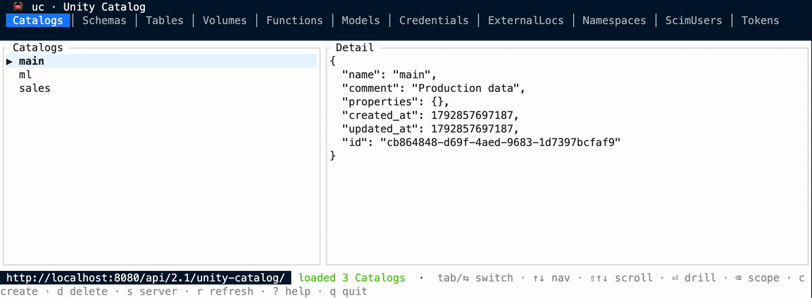

# unitycatalog-rs

A Rust reimplementation of [Unity Catalog OSS](https://github.com/unitycatalog/unitycatalog), the
open catalog for data and AI. It has upstream's REST APIs (Unity Catalog, Delta and Iceberg REST),
a web UI and the `uc` CLI, and keeps the catalog in an embedded database (Turso) or in PostgreSQL.

The web UI, with sign-in through FerrisKey, as in `just demo-auth`:



The terminal UI of `uc`:



## Java and Rust

What upstream (Java) and this project (Rust) have.

| Feature | Java | Rust | Notes |
| --- | :-: | :-: | --- |
| Unity Catalog REST API: catalogs, schemas, tables, volumes, functions, models, grants | X | X | |
| Delta REST API (managed Delta tables) | X | X | |
| Iceberg REST catalog | X | X | |
| Temporary cloud credentials (AWS, Azure, GCP) | X | X | |
| Authorization with privileges | X | X | Rust can also use Cedar policies |
| Sign-in with an identity provider's tokens (token exchange) | X | X | |
| SCIM users | X | X | Rust also has groups and bulk changes |
| Personal access tokens, OAuth client credentials | | X | |
| Delta Sharing server | | X | |
| Web UI | X | X | Java signs in in the browser (Google, Okta, Keycloak buttons); Rust on the server (OpenID Connect, or an auth proxy) |
| `uc` CLI | X | X | Rust adds a terminal UI and `uc serve`, `uc dev`, `uc web` |
| Python client | X | X | Different APIs: `unitycatalog-client` and `unitycatalog-rs` |
| Java client | X | | |
| Spark and Hadoop connectors | X | | Upstream's connectors are not tested against the Rust server |
| `unitycatalog-ai` (functions as LLM tools) | X | | |
| Embedded database | X | X | Java: H2. Rust: Turso |
| Settings | X | X | Java: `etc/conf/*.properties`. Rust: `uc.toml` and `UC_*` variables |
| PostgreSQL | X | X | |
| MySQL | X | | |
| Prometheus metrics, health probes | X | X | |
| Audit log, backup and restore, OpenTelemetry traces, rate limiting | | X | |
| Docker image, Helm chart | X | X | |
| Server and web UI from `pip install` | | X | |
| Docs site | X | X | |

## Use it from Python

```bash
pip install 'unitycatalog-rs[all]'   # the Python client, the uc CLI, the server and the web UI
uc dev                               # a server on http://localhost:8080, with the web UI
uc catalog list                      # upstream's bin/uc commands
```

```python
from unitycatalog import Client

client = Client("http://localhost:8080/")
print([catalog.name for catalog in client.list_catalogs()])
```

The extras `cli`, `server` and `ui` install only those parts.

In a checkout of this repository, `just develop` builds the four packages and installs them into
`.venv`. `just demo` does the same, then runs `uc dev` from `.venv` on http://localhost:8080, with
dummy data (`examples/seed_demo.py`). `just demo-auth` adds sign-in and S3, in Docker
(`examples/demo-auth`): users sign in as alice or bob with FerrisKey, an OpenID Connect provider,
and the data is in RustFS, an S3-compatible store.

## Configure it

A setting comes from its `UC_<GROUP>_<KEY>` variable, else from the `[group]` table of `uc.toml`
(`--config`, else `UC_CONFIG`, else `uc.toml` in the working directory or a folder above):
`UC_AUTH_ENABLED=true` is `enabled = true` in `[auth]`. A key that is not a setting is an error.

```toml
# uc.toml
[server]
data_dir = "/var/lib/uc"           # the embedded database; default .uc

[db]
url = "postgresql://uc@postgres.example.com:5432/uc?sslmode=verify-full"

[auth]
enabled = true
allowed_issuers = ["https://accounts.google.com"]
signing_key_file = "/etc/uc/signing-key.pem"  # the key of its tokens; default a new one in memory

[s3.analytics]                     # a bucket's credentials, for paths without an external location
bucket = "s3://analytics"
region = "us-east-1"
role_arn = "arn:aws:iam::123456789012:role/uc"
```

## Run it in production with Helm

```bash
helm install uc oci://ghcr.io/ion-elgreco/charts/uc-server -f values.yaml
```

```yaml
# values.yaml
server:
  db:
    type: postgresql               # several replicas can share it; `file` is one replica
    postgresqlConfig:
      host: postgres.example.com
      passwordSecretName: uc-db    # a Secret with the database password
auth:
  enabled: true
  publicUrl: https://uc.example.com
  oidc:                            # the server signs users in to the web UI
    issuer: https://accounts.google.com
    clientSecretName: uc-oauth     # a Secret with clientId and clientSecret
  users:                           # made at each start when missing
    - email: alice@example.com
      name: Alice
      privileges: ["CREATE CATALOG"]
ingress:
  enabled: true
  host: uc.example.com
```

The chart runs the image `ghcr.io/ion-elgreco/unitycatalog-rs`: the server and the web UI on
distroless, as a non-root user on a read-only root filesystem, with an SBOM and build provenance.
[values.yaml](deploy/helm/uc-server/values.yaml) documents every setting, such as cloud storage
credentials and sign-in through an auth proxy (`auth.forward`).
