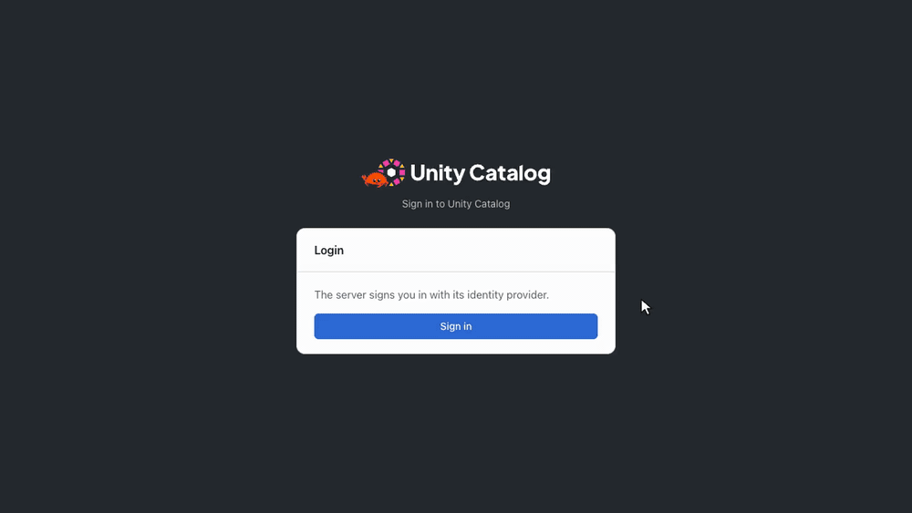
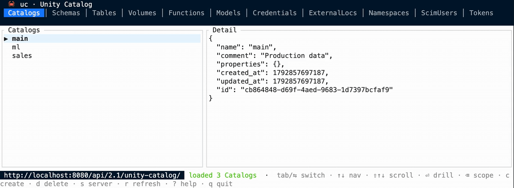

# unitycatalog-rs

A Rust reimplementation of [Unity Catalog OSS](https://github.com/unitycatalog/unitycatalog), the
open catalog for data and AI. It has upstream's REST APIs (Unity Catalog, Delta and Iceberg REST),
a web UI and the `uc` CLI, and keeps the catalog in an embedded database (Turso) or in PostgreSQL.

The web UI, with sign-in through FerrisKey, as in `just demo-auth`:



The terminal UI of `uc`:



## Features compared with Unity Catalog OSS

What upstream Unity Catalog OSS (Java) and unitycatalog-rs (Rust) have.

<table>
<thead>
<tr><th>Feature</th><th>Unity Catalog OSS (Java)</th><th>unitycatalog-rs (Rust)</th><th>Notes</th></tr>
</thead>
<tbody>
<tr><th colspan="4" align="left"><strong>APIs</strong></th></tr>
<tr><td>Unity Catalog REST API: catalogs, schemas, tables, volumes, functions, models, grants</td><td align="center">✓</td><td align="center">✓</td><td></td></tr>
<tr><td>Delta REST API (managed Delta tables)</td><td align="center">✓</td><td align="center">✓</td><td></td></tr>
<tr><td>Iceberg REST catalog</td><td align="center">✓</td><td align="center">✓</td><td></td></tr>
<tr><td>Temporary cloud credentials (AWS, Azure, GCP)</td><td align="center">✓</td><td align="center">✓</td><td></td></tr>
<tr><td>Delta Sharing and Open Sharing server</td><td align="center"></td><td align="center">✓</td><td>Tables, volumes and agent skills</td></tr>
<tr><td>Files API (read and write files in volumes)</td><td align="center"></td><td align="center">✓</td><td>Same shape as Databricks' <code>/api/2.0/fs</code></td></tr>
<tr><td>Search for catalogs, schemas, tables and other objects by name</td><td align="center"></td><td align="center">✓</td><td></td></tr>
<tr><th colspan="4" align="left"><strong>Sign-in and access</strong></th></tr>
<tr><td>Sign-in with an identity provider's tokens (token exchange)</td><td align="center">✓</td><td align="center">✓</td><td></td></tr>
<tr><td>Personal access tokens</td><td align="center"></td><td align="center">✓</td><td></td></tr>
<tr><td>OAuth client credentials (machine sign-in)</td><td align="center"></td><td align="center">✓</td><td></td></tr>
<tr><td>Authorization with privileges</td><td align="center">✓</td><td align="center">✓</td><td></td></tr>
<tr><td>Authorization with Open Policy Agent</td><td align="center">✓</td><td align="center">✓</td><td></td></tr>
<tr><td>Authorization with Cedar policies</td><td align="center"></td><td align="center">✓</td><td></td></tr>
<tr><td>SCIM users</td><td align="center">✓</td><td align="center">✓</td><td></td></tr>
<tr><td>SCIM groups</td><td align="center"></td><td align="center">✓</td><td></td></tr>
<tr><td>SCIM bulk changes</td><td align="center"></td><td align="center">✓</td><td></td></tr>
<tr><th colspan="4" align="left"><strong>Web UI</strong></th></tr>
<tr><td>Web UI</td><td align="center">✓</td><td align="center">✓</td><td></td></tr>
<tr><td>Sign-in in the browser (Google, Okta, Keycloak buttons)</td><td align="center">✓</td><td align="center"></td><td></td></tr>
<tr><td>Sign-in on the server with OpenID Connect</td><td align="center"></td><td align="center">✓</td><td></td></tr>
<tr><td>Sign-in through an auth proxy (forward auth)</td><td align="center"></td><td align="center">✓</td><td></td></tr>
<tr><td>Search box</td><td align="center"></td><td align="center">✓</td><td></td></tr>
<tr><td>Browse and view the files of volumes and tables</td><td align="center"></td><td align="center">✓</td><td></td></tr>
<tr><th colspan="4" align="left"><strong>Clients</strong></th></tr>
<tr><td><code>uc</code> CLI</td><td align="center">✓</td><td align="center">✓</td><td></td></tr>
<tr><td>Terminal UI in <code>uc</code></td><td align="center"></td><td align="center">✓</td><td></td></tr>
<tr><td><code>uc serve</code>, <code>uc dev</code>, <code>uc web</code> (start a server or the web UI)</td><td align="center"></td><td align="center">✓</td><td></td></tr>
<tr><td>Python client</td><td align="center">✓</td><td align="center">✓</td><td>Different APIs: <code>unitycatalog-client</code> and <code>unitycatalog-rs</code></td></tr>
<tr><td>Java client</td><td align="center">✓</td><td align="center"></td><td></td></tr>
<tr><td>Spark and Hadoop connectors</td><td align="center">✓</td><td align="center"></td><td>Upstream's Spark connector works with the Rust server: CI tests it with Spark 4.1 and 4.2</td></tr>
<tr><td><code>unitycatalog-ai</code> (functions as LLM tools)</td><td align="center">✓</td><td align="center"></td><td></td></tr>
<tr><th colspan="4" align="left"><strong>Storage and operations</strong></th></tr>
<tr><td>Embedded database</td><td align="center">✓</td><td align="center">✓</td><td>Java: H2. Rust: Turso</td></tr>
<tr><td>PostgreSQL</td><td align="center">✓</td><td align="center">✓</td><td></td></tr>
<tr><td>MySQL</td><td align="center">✓</td><td align="center"></td><td></td></tr>
<tr><td>Encrypted credential secrets</td><td align="center">✓</td><td align="center">✓</td><td></td></tr>
<tr><td>Key rotation for credential secrets</td><td align="center"></td><td align="center">✓</td><td></td></tr>
<tr><td>Settings</td><td align="center">✓</td><td align="center">✓</td><td>Java: <code>etc/conf/*.properties</code>. Rust: <code>uc.toml</code> and <code>UC_*</code> variables</td></tr>
<tr><td>Prometheus metrics, health probes</td><td align="center">✓</td><td align="center">✓</td><td></td></tr>
<tr><td>Audit log</td><td align="center">✓</td><td align="center">✓</td><td></td></tr>
<tr><td>Backup and restore</td><td align="center"></td><td align="center">✓</td><td></td></tr>
<tr><td>OpenTelemetry traces</td><td align="center"></td><td align="center">✓</td><td></td></tr>
<tr><td>Rate limiting</td><td align="center"></td><td align="center">✓</td><td></td></tr>
<tr><td>Docker image, Helm chart</td><td align="center">✓</td><td align="center">✓</td><td></td></tr>
<tr><td>Hardened image</td><td align="center"></td><td align="center">✓</td><td>Distroless (no shell or package manager), read-only root file system in Helm, SBOM and signed provenance. Java: Alpine with bash</td></tr>
<tr><td>Server and web UI from <code>pip install</code></td><td align="center"></td><td align="center">✓</td><td></td></tr>
<tr><td>Docs site</td><td align="center">✓</td><td align="center">✓</td><td></td></tr>
</tbody>
</table>

## Use it from Python

```bash
pip install 'unitycatalog-rs[all]'   # the Python client, the uc CLI, the server and the web UI
uc dev                               # a server on http://localhost:8080, with the web UI
uc catalog list                      # upstream's bin/uc commands
```

```python
from unitycatalog import Client

client = Client("http://localhost:8080/")
print([catalog.name for catalog in client.list_catalogs()])
```

The extras `cli`, `server` and `ui` install only those parts.

In a checkout of this repository, `just develop` builds the four packages and installs them into
`.venv`. `just demo` does the same, then runs `uc dev` from `.venv` on http://localhost:8080, with
dummy data (`examples/seed_demo.py`). `just demo-auth` adds sign-in and S3, in Docker
(`examples/demo-auth`): users sign in as alice or bob with FerrisKey, an OpenID Connect provider,
and the data is in RustFS, an S3-compatible store.

## Configure it

A setting comes from its `UC_<GROUP>_<KEY>` variable, else from the `[group]` table of `uc.toml`
(`--config`, else `UC_CONFIG`, else `uc.toml` in the working directory or a folder above):
`UC_AUTH_ENABLED=true` is `enabled = true` in `[auth]`. A key that is not a setting is an error.

```toml
# uc.toml
[server]
data_dir = "/var/lib/uc"           # the embedded database; default .uc

[db]
url = "postgresql://uc@postgres.example.com:5432/uc?sslmode=verify-full"

[secrets]
key_file = "/etc/uc/secrets-key.pem"  # the key of the secrets of credentials

[auth]
enabled = true
signing_key_file = "/etc/uc/signing-key.pem"  # the key of its tokens; default a new one in memory

[[auth.issuers]]                   # an identity provider whose tokens the server takes
name = "google"
issuer = "https://accounts.google.com"
audiences = ["<client id>"]

[identity.aws]                     # the server's AWS identity; default the environment's
region = "us-east-1"

[locations.analytics]              # a URL and its identity, for paths without an external location
url = "s3://analytics"
aws_iam_role_arn = "arn:aws:iam::123456789012:role/uc"
```

## Run it in production with Helm

```bash
helm install uc oci://ghcr.io/open-lakehouse/charts/uc-server -f values.yaml
```

```yaml
# values.yaml
server:
  db:
    type: postgresql               # several replicas can share it; `file` is one replica
    postgresqlConfig:
      host: postgres.example.com
      passwordSecretName: uc-db    # a Secret with the database password
auth:
  enabled: true
  publicUrl: https://uc.example.com
  oidc:                            # the server signs users in to the web UI
    issuer: https://accounts.google.com
    clientSecretName: uc-oauth     # a Secret with clientId and clientSecret
  users:                           # made at each start when missing
    - email: alice@example.com
      name: Alice
      privileges: ["CREATE CATALOG"]
ingress:
  enabled: true
  host: uc.example.com
```

The chart runs the image `ghcr.io/open-lakehouse/unitycatalog-rs`: the server and the web UI on
distroless, as a non-root user on a read-only root filesystem, with an SBOM and build provenance.
[values.yaml](deploy/helm/uc-server/values.yaml) documents every setting, such as cloud storage
credentials and sign-in through an auth proxy (`auth.forward`).
