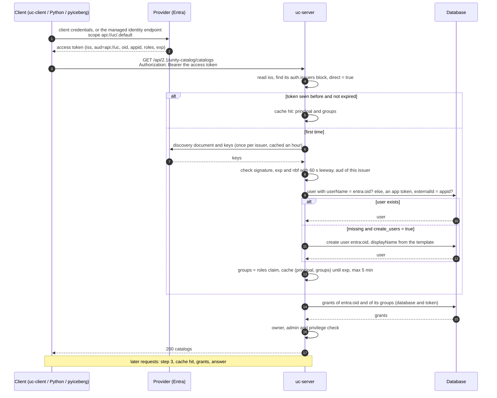
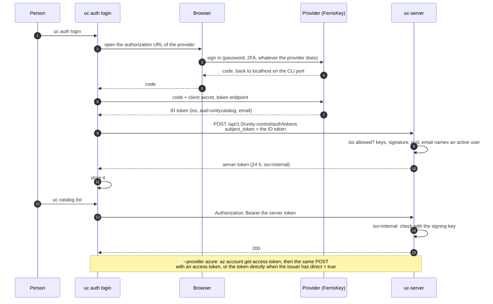
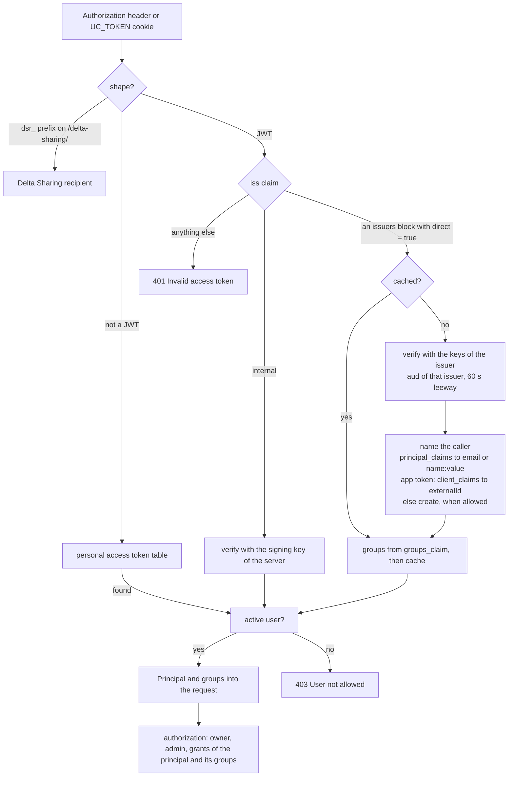

# Plan: sign in with cloud identities

Written on 2026-10-29. A client should be able to call the server with the identity its
environment already has: an Azure service principal or managed identity, a Google service
account, a Kubernetes service account, a CI job, or any OpenID Connect provider. The server should
accept that identity, and privileges should be grantable to it, alone or through its groups.

Terms used below:

- **Provider**: the service that issues identity tokens, such as Microsoft Entra, Google, or
  FerrisKey. **Issuer** is the provider's `iss` value in a token.
- **Token exchange**: the client gives the server a provider token and gets a server token back
  (`POST /api/1.0/unity-control/auth/tokens`). `uc auth login` does this.
- **Direct acceptance**: the client sends the provider token on every request, and the server
  checks it each time. This is new.
- **Principal**: the name a grant or an owner refers to. Today it is the user's email.

## What exists

- The server accepts only its own tokens on the API: the ones its signing key made, personal
  access tokens, and Delta Sharing recipient tokens. Provider tokens enter only through the
  exchange (`crates/uc-server/src/routes/control/mod.rs`, `crates/uc-server/src/authn/idp.rs`).
- The exchange checks the token's issuer against `auth.allowed_issuers`, fetches that issuer's
  keys through OpenID discovery (cached per issuer), checks `aud` against `auth.audiences`, and
  names the caller: an ID token by `email`, else `sub`; an access token by `azp`, else
  `client_id`, matched to a user's `externalId`, else by `email` or `sub`. The user must exist
  and be active, else "User not allowed".
- `auth.audiences` is one list for every issuer. With two providers, a token of one with an
  audience meant for the other passes. The new settings put the audiences inside each issuer.
- The JWT check allows no clock skew (`leeway = 0`), and reads neither `appid` (Entra v1
  tokens) nor `oid`.
- The generated clients hold one bearer token string. `uc auth login` sends the exchange an ID
  token from the browser flow or `--identity_token`; it cannot send an access token, which is
  what a machine has.
- Privileges: grants to a user's email or a group's name; the creator owns what it makes;
  `auth.admin_principals` by email; Cedar sees `User::"<email>"`.

## Decisions

Open, to settle before the work starts:

1. **Direct acceptance next to the exchange**, or exchange only. Recommended: both. Engines such
   as pyiceberg and Spark send provider tokens and cannot call the exchange; with direct
   acceptance, pyiceberg's `auth.type: entra` works against our Iceberg REST endpoint with
   nothing of ours in the client.
2. **The name of an identity without an email.** Recommended: a user whose `userName` is
   `<issuer name>:<id>`, such as `entra:7f3e…`. Grants, owners, `admin_principals` and Cedar
   already take a `userName` when a user has no email. The alternative is a SCIM
   `ServicePrincipals` resource with an `applicationId`, as Databricks has; more work, and a new
   Cedar principal type. Add it later if the Databricks SDK and Terraform shapes for service
   principals matter.
3. **Where the Python helpers live** (`unitycatalog.auth.azure(...)` and friends). Recommended:
   a hand-written module in the `unitycatalog` package. The generated-clients rule covers API
   routes; these are not routes. The alternative is an opt-in file generated by trestle.
4. **AWS now or later.** AWS identities have no token of this kind. Recommended: a later phase
   (see [AWS](#aws)).

Settled:

- The settings change outright: `allowed_issuers` and `audiences` go, `[[auth.issuers]]` comes.
  Nothing is released, so no compatibility.
- `oidc_*` stays as the web UI's sign-in, one provider. It usually names one of the issuers.
- Groups come from the token as names, and count only when a group of that name exists in the
  server. Grants stay explicit.
- The server never learns how the client got its token. The client side only needs "a fresh
  token when asked".
- The clients find cloud identities with `olai-http`'s credential resolvers, the object_store
  ones, not with cloud SDKs and not with its HTTP client. Azure first, with one small change in
  the trestle fork: the scope reaches every Azure provider. Google ID tokens and AWS follow.

## Flows

### A machine calls the API directly

An Azure service principal, with the `entra` block above. The same sequence holds for a Google
service account or a Kubernetes pod, with their provider.



### A person signs in with the CLI: the exchange

Unchanged from today, except that an access token can be exchanged too.



### What the server does with a bearer value



## Server

### Settings

One block per issuer, in `crates/uc-common/src/settings.rs`:

```toml
[[auth.issuers]]
name = "entra"
issuer = "https://login.microsoftonline.com/<tenant>/v2.0"
audiences = ["api://uc"]
direct = true
principal_claims = ["email", "preferred_username", "oid"]
client_claims = ["azp", "appid"]
groups_claim = "roles"            # Entra app roles arrive as names; `groups` as object ids
create_users = true
display_name = "{app_displayname}"

[[auth.issuers]]
name = "entra-v1"                 # the same tenant, while the API app issues v1 tokens
issuer = "https://sts.windows.net/<tenant>/"
audiences = ["api://uc"]
direct = true
principal_claims = ["upn", "oid"]
client_claims = ["appid"]

[[auth.issuers]]
name = "google"
issuer = "https://accounts.google.com"
audiences = ["uc"]                # the audience the ID token was requested for
direct = true
principal_claims = ["email", "sub"]
create_users = true

[[auth.issuers]]
name = "ferriskey"
issuer = "http://localhost:8090/realms/unitycatalog"
audiences = ["unitycatalog"]
direct = false                    # exchange only, as today
```

| Key | Meaning | Default |
| --- | --- | --- |
| `name` | A short name; the prefix of the principals it names without an email. | required |
| `issuer` | The `iss` claim; `*` stands for one DNS label. | required |
| `audiences` | The `aud` the tokens must carry; `*` alone for any. | required |
| `direct` | Take its tokens on every request, not only at the exchange. | `false` |
| `principal_claims` | The claims that name the caller; the first present wins. An email names the user with that email; any other value names the user `<name>:<value>`. | `["email", "sub"]` |
| `client_claims` | The claims with a machine's client id, matched to a user's `externalId`. | `["azp", "client_id"]` |
| `groups_claim` | A claim whose values are names of groups the caller is in. | none |
| `create_users` | Make the user at its first request when it is missing. | `false` |
| `display_name` | The display name of a made user, with claims in braces. | the principal |

After parsing, each block is an `IssuerSettings` with two `Allowlist`s (the type `idp.rs` has),
and `AuthSettings::issuer(iss)` finds the block an `iss` matches.

### Direct acceptance

In `authenticate` (`crates/uc-server/src/authn/middleware.rs`), the JWT branch reads `iss` before
anything else. `internal` is the server's own token, checked as today. Any other issuer must have
a block with `direct = true`, else the token is invalid:

```rust
let principal = if looks_like_jwt(token) {
    let decoded = idp::decode(token).map_err(|_| invalid())?;
    match idp::claim(&decoded.claims, "iss") {
        Some(INTERNAL_ISSUER) => security.verify(token)?.sub,
        Some(iss) => match state.auth.issuer(iss) {
            Some(issuer) if issuer.direct => idp::accept(state, issuer, token, &decoded).await?,
            _ => return Err(invalid()),
        },
        None => return Err(invalid()),
    }
} else {
    // personal access tokens, unchanged
};
```

`accept` is the middle of today's exchange handler, moved to `idp.rs` so both paths share it:
verify the signature with the issuer's keys, check the audience of that issuer, resolve the
principal. A cache keyed by the token's hash (moka, already a dependency) keeps the result until
the token expires, at most five minutes, so a busy client costs one signature check and two
lookups per token, not per request. The cap bounds how long a user disabled in the server keeps
working with a token that was already accepted.

The exchange handler calls the same three steps and then signs its own token, as now. `leeway`
becomes 60 seconds.

### Naming the caller

`resolve_principal` becomes a walk over the issuer's claims. A token that names a person is
matched as a person; only an application's own token is matched by its client id, as the
exchange does today. A person's token from `az` or `gcloud` carries the client id of that tool
in `azp`, not the person, so the client id must not come first for them.

1. Each of `principal_claims` in order: the first claim present names the caller. A value with
   `@` is an email and names the user with that email, unless the provider says
   `email_verified: false`. Any other value is `<issuer name>:<value>`, and names the user with
   that `userName`.
2. Nobody found, and the token is an application's own (no email-like claim, or `idtyp = app`):
   each of `client_claims` in order; the first value that is a user's `externalId` names that
   user. This is how a pre-created user maps to a service principal.
3. Nobody found: with `create_users`, make the user, else "User not allowed".

The UI's sign-in callback resolves its ID token through the same walk, with the block that
`oidc_issuer` matches, so a first sign-in makes the user when that block has `create_users`.
The ID token of the UI and the access token of a CLI must name a person with the same claim:
`email` is optional at Entra and can differ from the UPN, so `preferred_username` or `oid` is
the safer key for both.

A made user has `userName` = the principal, the email when the principal is one, `externalId` =
the first client claim present, and `displayName` from the template. `ScimUser::principal()`
already returns `userName` when there is no email, so `entra:7f3e…` works wherever a principal
is read. The bootstrap `admin` can never be named this way.

### Groups

`Principal` carries the groups of the token (`groups_claim`). `Access::load` passes them to
`grants_of(principal, &groups)`, which adds `OR principal IN (<groups>)` next to the membership
subquery, matched on the group's `display_name`. A name the server has no group for counts for
nothing. The admin makes the group once and grants to it; every identity whose token names it is
covered.

Entra's `groups` claim holds object ids, not names. The example uses `roles`: app roles of the
API app, assigned to Entra groups, arrive as names. Matching `groups` on a group's `externalId`
is a small follow-up.

### Providers

| Provider | Token | How the client gets it | Notes |
| --- | --- | --- | --- |
| Entra | v2 access token for the API app (`api://uc/.default`) | the `olai-http` Azure resolver: client secret, managed identity, workload identity, Azure CLI | Set `accessTokenAcceptedVersion` to 2 on the API app, or list the v1 issuer too. `idtyp: app` tells apps from people. Only tokens for our own app verify; Graph tokens do not. |
| Google | ID token with our audience | the `olai-http` Google resolver, once it requests ID tokens: key file, metadata server, workload identity federation | Google access tokens are opaque and stay out. |
| Any OpenID provider | access or ID token | the provider's client-credentials or device flow | FerrisKey, Keycloak, Okta, GitHub Actions, GitLab CI, a Kubernetes cluster's issuer. |
| Kubernetes | service-account token | projected volume | Through the cluster's OpenID issuer when it is reachable. A TokenReview check for clusters without one comes later. |
| Databricks | workspace OAuth token | the Databricks SDK | Only if its issuer publishes discovery and keys; to verify before promising. |

#### AWS

An AWS identity cannot produce a token a third party verifies. The established pattern is a
presigned `sts:GetCallerIdentity` request as the bearer value: the server sends it to STS, STS
answers with the caller's ARN, and the ARN is the principal (`aws:arn:aws:iam::…:role/etl`).
Vault and the EKS authenticator work this way. It is its own small design: a new token shape in
the middleware, an STS call with a cache, and an issuer block of kind `aws` with the allowed
accounts. Later phase.

### Tests

The exchange tests (`crates/uc-server/tests/control.rs`) already run an in-process issuer with
discovery and keys. New cases:

- An Entra-shaped app token (`oid`, `appid`, `idtyp: app`, no `email`) on a `direct` issuer:
  200; the user `entra:<oid>` exists afterwards; a created catalog's owner is that principal.
- The same with `create_users = false`: 403 "User not allowed". With a pre-created user whose
  `externalId` is the `appid`: 200 as that user.
- Wrong `aud`, wrong `iss`, expired, a token signed with a key the issuer no longer publishes:
  401. An unknown key id triggers one refetch.
- `direct = false`: 401 on the API, 200 at the exchange.
- Two issuers at once, each with its own audience: a token of one with the other's audience is
  refused. No test covers two issuers today.
- `roles` with a group that exists: a grant to the group lets the call through; the same name
  without a group: 403.
- The cache: a user disabled inside the window still passes; after it, 403.
- 60 seconds of skew on `exp`, `nbf` and `iat` pass; more does not.

## Clients

### The generated transport (trestle)

The transport gets a token source instead of a string:

```rust
/// Where the bearer token of each request comes from.
pub trait TokenSource: Send + Sync {
    /// A token and when it expires; `None` for one that does not.
    async fn token(&self) -> Result<(String, Option<Instant>), Error>;
}
```

`with_token(s)` becomes a source that always returns `s`. The transport keeps the last token and
asks the source again within a minute of its expiry. The service clients do not change. This is
generic, so it goes into trestle's generated `transport.rs` and the aggregate client
(`new_with_token_source`), folded into the branch's first commit as the other options were.

### The cloud sources (olai-http)

`olai-http`'s builders hand back a public credential provider:
`AzureBuilder::from_env().build(None)?.credentials`, and the same for Google and AWS.
`get_credential()` on it is the token, cached and refreshed inside. A `TokenSource` over that is
a few lines in `uc-client`, behind a cargo feature per cloud. The HTTP client of `olai-http` is
not used; the generated reqwest transport stays.

The resolvers find the identity right. What they ask for with it is where the work is:

| Provider | State | Change |
| --- | --- | --- |
| Azure, client secret | takes `azure_scope` | none |
| Azure, managed identity, workload identity, Azure CLI | ask for a storage token | pass the scope through, in the fork: about thirty lines in three constructors |
| Google | access tokens, opaque | an ID-token request with our audience next to each access-token one, in the fork |
| AWS | credentials and a SigV4 signer, no token | presign `sts:GetCallerIdentity` as the bearer value (see [AWS](#aws)) |
| Any other OpenID provider | nothing | client credentials against a token URL, in the fork or in `uc-client` |

Two costs: `olai-http` has no per-cloud cargo features, so one cloud brings the others and
`ring`, `tokio` and `hyper` along, which per-cloud features in the fork would trim; and it does
not build for `wasm32`, so the features stay off in the uc-ui build, which signs in with the
browser's session anyway.

### The pattern: the environment is the configuration

A user writes the server URL and nothing else. The client finds the identity in its
environment, as the Databricks SDK, `azure-identity` and pyiceberg's `entra` manager do, and
never shows a token to anyone:

```python
client = Client("https://uc.example.com")
```

At construction the default token source:

1. Picks a provider from the environment: `AZURE_CLIENT_ID`, `AZURE_CLIENT_SECRET` and
   `AZURE_TENANT_ID` (a service principal), `AZURE_FEDERATED_TOKEN_FILE` (workload identity),
   the managed identity endpoint, `GOOGLE_APPLICATION_CREDENTIALS` or the GCE metadata server,
   `UC_TOKEN` (a fixed token, as today), else the `az` or `gcloud` sign-in of a laptop, else
   none.
2. Asks the server what it accepts: `GET /.well-known/oauth-protected-resource` (RFC 9728)
   answers with the resource name (`api://uc`) and the issuers. So the scope is not client
   configuration. Engines that do not read it set the scope by hand, as pyiceberg does.
3. Requests a token for that scope, keeps it, and requests a new one a minute before it expires.
4. Puts it on every request.

Rotating a secret is one environment variable. Moving from a laptop to a pod is removing the
variables. No code changes. The server publishes the metadata endpoint; the rest is client side.

### Python

`Client(url)` uses the default source above. `Client(url, token_provider=f)` replaces it for the
odd case: `f` returns a string or a `(token, expires_at)` pair, and the binding wraps it in a
`TokenSource` that takes the GIL to call it (the sync methods release the GIL, so the call can
run). The pieces of the default chain are importable for that:

```python
from unitycatalog.auth import azure, google, oauth2

Client(url, token_provider=google(audience="uc"))                 # the Google source, an ID token
Client(url, token_provider=oauth2(token_url, client_id, secret))  # any provider, client credentials
```

The wheel carries the Rust chain, so Python needs no cloud libraries; the helpers above are thin
wrappers of it.

### CLI

The CLI uses the same default source: with the Azure or Google variables in the environment it
needs no sign-in at all, and on a laptop it takes the `az` or `gcloud` sign-in when the server
lists that issuer. `uc auth login` stays for providers without an environment chain, such as
FerrisKey, and gains `--access_token` so an access token can be exchanged too; today only ID
tokens can. `UC_CLI_TOKEN` keeps working for a token obtained elsewhere.

## Steps

1. Server: issuer blocks, direct acceptance with the cache, `appid` and `oid`, users made on
   first contact, groups from the token, 60 seconds of leeway, the
   `/.well-known/oauth-protected-resource` endpoint. Docs: `docs/server/auth.md`,
   `docs/reference/settings.md`, Helm values.
2. trestle: `TokenSource` in the generated transport and aggregate client, `token_provider` in
   the Python bindings. Pin and regenerate.
3. Azure end to end: the scope through the three Azure providers in the fork's `olai-http`;
   the Azure `TokenSource`, the environment chain and the metadata lookup in `uc-client`
   behind a feature; exposed by the Python package and the CLI; `uc auth login
   --access_token`.
4. Google ID tokens in the fork's `olai-http`, and the Google source. AWS through STS.
5. Later, if wanted: per-cloud features in `olai-http`, a TokenReview check for Kubernetes,
   `groups` matched on a group's `externalId`, group lookups at the provider for tokens that
   truncate the claim, a SCIM `ServicePrincipals` resource.

## Background

- Lakekeeper issues no tokens at all: the provider token is checked on every request, the user
  is `oidc~<oid>` and is created on the first call, grants can be written before that call. No
  personal access tokens, no exchange, no auth proxy; anything that is not OpenID or Kubernetes
  means a provider in front or a custom build. Our design keeps the exchange, the personal
  access tokens and the proxy mode, and adds their direct path.
- pyiceberg ships `noop`, `basic`, `oauth2` (any token endpoint), `entra` (`DefaultAzureCredential`),
  `google`, `legacyoauth2` and `custom` auth managers, plus SigV4 and static headers. No
  interactive flow. The `entra` and `google` managers are what step 1 lets through unchanged.
- `olai-http` has credential chains for Azure, Google, AWS and Databricks, lifted from
  object_store. Its HTTP client is not used here: its retry layer hides error bodies from the
  generated error module, it does not build for `wasm32`, and its signer seam is private. Its
  credential resolvers are public and are what the token sources are built on, with the gaps
  listed under [The generated transport](#the-generated-transport-trestle).
