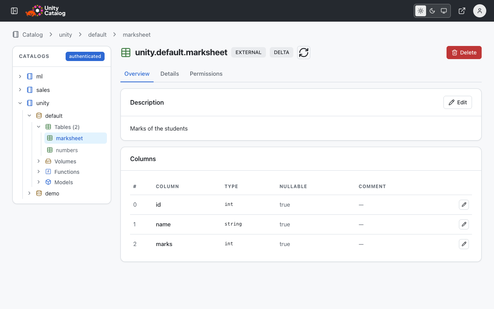
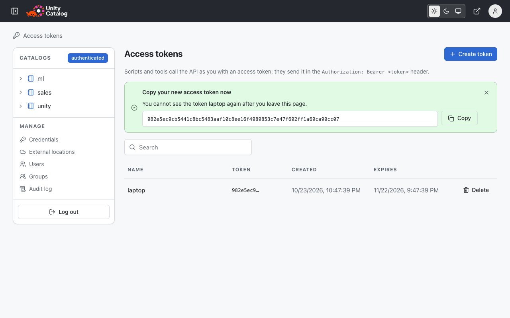

# Web UI

The web UI shows the catalogs of a server, and creates, edits and deletes what they hold. It is a
port of upstream's new console, with grants, temporary credentials, column comments, a page for
your access tokens, and the pages under **Manage**. `uc-server` serves it at `/`.

<video src="../assets/ui/web-ui.mp4" poster="../../assets/ui/catalogs.png" autoplay loop muted playsinline controls aria-label="Sign in with an OpenID Connect provider, create a catalog, find a table with the search box, browse to a volume, view an image of its files, delete the catalog, and log out"></video>

## Open it

- `uc dev` runs a server with the UI, and opens it in your browser.
- The [image](../server/docker.md) and the [Helm chart](../server/kubernetes.md) serve the UI at
  `/`.
- `uc web` serves the UI on <http://localhost:3000>, for another server (`--server`), with the
  token of `uc`.

When the server needs a sign-in, the UI shows its login page first: see
[Sign-in and authorization](../server/auth.md#sign-in-to-the-web-ui).

## Use it

- **Catalogs**, on the left, is the tree of catalogs, schemas, and the tables, volumes, functions
  and models of each schema. Click a name to open its page.
- Each page has three tabs: **Overview** (the description and what the object holds),
  **Details** (its fields, properties and JSON) and **Permissions**. Volumes and tables also have
  **Files**.
- **Create**: **Create catalog** on the list of catalogs, **Create schema** on a catalog, and
  **New** on a schema, for a table, volume, SQL function or registered model. A new table is
  managed, or external at a storage location, with any number of columns. The Iceberg REST
  catalog creates an Iceberg table, with its first metadata file.
- **Edit**: the button at the top of a page, or **Edit** on the description. The pencil in a
  column's row edits the column's comment.
- **Delete**: the button at the top of a page; type the name to confirm. The server deletes only
  a catalog, schema, model or credential that holds nothing; an admin can tick a box to delete
  what it holds too.
- The buttons at the right of the header choose the light theme, the dark theme or the system's.

## Search

The box in the header finds catalogs, schemas, tables, volumes, functions and models by the words
of their names and comments. Press `/` to go to it.

- Type at least two characters: the first results show under the box. The arrow keys and Enter,
  or a click, open one.
- **See all results**, or Enter without a marked result, opens the search page: all the results,
  with a tab for each type, and **Load more** for the next page.
- Names equal to the text come first, then names that start with it, names that hold it, and the
  objects whose comment holds its words. You see only the objects that you may read.
- On Turso, a word matches anywhere in a word: `rders` finds `sales_orders`. On PostgreSQL, a word
  matches the start of a word: `ord` finds `sales_orders`, `rders` does not.

## Files

The **Files** tab of a volume or table shows the files in its storage location. Click a folder to
open it, and a name in the path above the list to go back. The download button gets a file.

Click a file to view it. The viewer shows text, JSON (pretty-printed; for a Delta log, one document
per line), CSV and TSV files as a table, and images (PNG, JPEG, GIF, WebP, SVG, BMP, AVIF, up to
10 MB). It reads a large file 512 KB at a time: scroll down for more, up to 10 MB. Parquet, Avro
and other binary files have no preview: download them.

The owner of a volume also sees **Upload** (one or more files, with a box to replace files that
are there), **New folder**, and a delete button in each row. For a folder that holds files, the
dialog says what it holds; tick the box to delete them too. The files of a table are read-only. See [Files API](rest-apis.md#files-api).

## Permissions

The Permissions tab shows your privileges on the object and its grants. The owner and admins can
grant a privilege to a user's email and revoke one with its ×. For tables, volumes and external
locations, **Vend READ creds** and **Vend READ WRITE creds** show temporary credentials for the
storage, as an engine gets them.

## Manage

Under the tree, **Manage** has the credentials and external locations, and, for admins, the users,
groups and audit log:

- **Credentials**: an AWS IAM role that the server assumes, an Azure service principal or
  managed identity that it signs in as, or a GCP service account or service account key, with
  the external locations bound to it.
- **External locations**: a URL in cloud storage and its credential. See
  [Cloud storage](../server/cloud-storage.md).
- **Users**: create a user by email; **Delete** deactivates the user.
- **Groups**: create a group, then add and remove its members on its page.
- **Audit log**: the calls that changed the catalog, with a filter by principal, method, path and
  time. A signed-in admin sees it.

## Access tokens

An access token lets a script call the API as you. Click the avatar, then **Access tokens**:

1. Click **Create token**, give a name, and choose when it expires.
2. Click **Copy**, and keep the token safe: the page shows it only once.
3. To stop a token, click **Delete** in its row.

