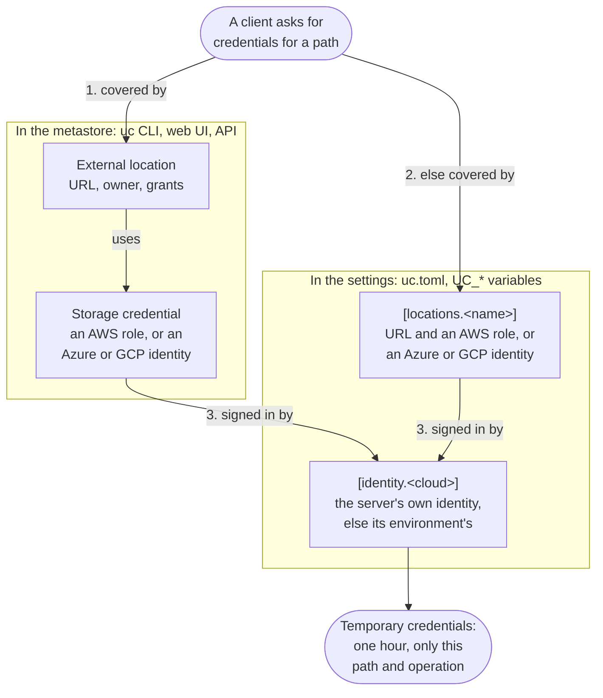

# Settings

`uc-server` and `uc` read the same settings. Each setting is a key in a `[group]` table of
`uc.toml`, and an environment variable `UC_<GROUP>_<KEY>`: `enabled` in `[auth]` is
`UC_AUTH_ENABLED`.

```toml
# uc.toml
[server]
data_dir = "/var/lib/uc"

[db]
url = "postgresql://uc@postgres.example.com:5432/uc?sslmode=verify-full"

[auth]
enabled = true
allowed_issuers = ["https://accounts.google.com"]
```

The same with variables:

```bash
export UC_SERVER_DATA_DIR=/var/lib/uc
export UC_DB_URL='postgresql://uc@postgres.example.com:5432/uc?sslmode=verify-full'
export UC_AUTH_ENABLED=true
export UC_AUTH_ALLOWED_ISSUERS=https://accounts.google.com
```

## Where the settings come from

A setting takes its value from the first of:

1. a command-line flag, such as `--port`;
2. its environment variable;
3. `uc.toml`;
4. its default.

The settings file is the file of `--config`, else the file that `UC_CONFIG` names, else the first
`uc.toml` in the working directory or a folder above it. Without a file, the variables and the
defaults apply.

## Values

- A key that is not a setting is an error, in the file and in a variable of a group. Errors name
  the setting, its variable and the file: `auth.enabld (UC_AUTH_ENABLD): unknown field`.
- Other `UC_` variables are not settings, such as `UC_CONFIG`.
- Variables are text. The server reads numbers and booleans from the text. An empty variable is
  unset.
- A duration is text such as `30s`, `5m`, `24h` or `5d`.
- A list is a TOML array, or text with commas: `UC_AUTH_ALLOWED_ISSUERS=https://a.example,https://b.example`.

## Cloud identities and locations

Three kinds of setup decide how the server reaches cloud storage:

| | Where you set it | What it is |
| --- | --- | --- |
| `[identity.<cloud>]` | `uc.toml`, `UC_IDENTITY_*` variables | Who the server is in AWS, Azure or GCP. Without it, the identity of the server's environment. |
| External location and storage credential | `uc external_location create` and `uc credential create`, the web UI or the API. The metastore keeps them. | A URL and the identity that reaches it, with an owner and grants. |
| `[locations.<name>]` | `uc.toml`, `UC_LOCATIONS_*` variables | A URL and the identity that reaches it, without an owner or grants. It is not an external location: `uc external_location list` does not show it. |

When a client asks for credentials for a path, the server first finds the identity for the
path: (1) the storage credential of the external location that covers it, else (2) the identity of
the `[locations.<name>]` that covers it. Then (3) it signs in with its own identity to get
temporary credentials of that identity:



What the server does for each identity:

| Identity of the location | The server |
| --- | --- |
| AWS IAM role | assumes the role as `[identity.aws]`; for `aws_iam_role_arn = true`, its own role `identity.aws.arn`. |
| Azure service principal | signs in as the service principal. |
| Azure managed identity | signs in as `[identity.azure]`, or as the user-assigned identity of the resource ID. |
| GCP service account | uses the token of `[identity.gcp]`, or impersonates the service account as `[identity.gcp]`. |
| GCP service account key | signs in with the key. |

With authorization on, external tables and volumes, the storage roots of catalogs and schemas,
and path credentials need an external location. The `[locations.<name>]` entries then serve only
`storage.tables_root` and `storage.models_root`. Where several locations cover a path, the longest
URL wins.

The variables of these tables include the cloud or the name: `UC_IDENTITY_AWS_SECRET_KEY` is
`secret_key` in `[identity.aws]`, and `UC_LOCATIONS_ANALYTICS_URL` is `url` in
`[locations.analytics]`. A name has only lowercase letters and digits, and at least one letter:
the server reads a name of only digits, such as `UC_LOCATIONS_0_URL`, as a list index.

### Examples per cloud

Each example has the server's identity, two locations and the managed roots. One location uses
the server's own identity (`true`). The other is a bucket or container that another identity
reaches. The managed roots are under the first location.

=== "AWS S3"

    ```toml
    # The server's AWS identity. Here it comes from the environment, such as
    # the IAM role of its pod (IRSA); arn names that role.
    [identity.aws]
    region = "eu-west-1"
    arn = "arn:aws:iam::111111111111:role/uc-server"

    # A bucket of the server's own account: the server assumes its own role.
    [locations.lake]
    url = "s3://acme-lake"
    aws_iam_role_arn = true

    # A bucket of another account: a role there, which trusts the server's role.
    [locations.partner]
    url = "s3://partner-data"
    region = "us-east-1"
    aws_iam_role_arn = "arn:aws:iam::222222222222:role/uc-partner"

    # Where managed tables and models go when their catalog and schema have no
    # storage root: here in the bucket of [locations.lake].
    [storage]
    tables_root = "s3://acme-lake/managed/tables"
    models_root = "s3://acme-lake/managed/models"
    ```

=== "Google Cloud Storage"

    ```toml
    # The server's GCP identity: a service account key. Without it, Application
    # Default Credentials, such as GKE Workload Identity.
    [identity.gcp]
    json_key_file = "/etc/uc/gcp/uc-server.json"

    # A bucket that the server's own service account can reach.
    [locations.lake]
    url = "gs://acme-lake"
    gcp_service_account = true

    # A bucket of another project: its service account, which the server's
    # account impersonates (Service Account Token Creator on that account).
    [locations.partner]
    url = "gs://partner-data"
    gcp_service_account = "uc-partner@partner-project.iam.gserviceaccount.com"

    # Where managed tables and models go when their catalog and schema have no
    # storage root: here in the bucket of [locations.lake].
    [storage]
    tables_root = "gs://acme-lake/managed/tables"
    models_root = "gs://acme-lake/managed/models"
    ```

=== "Azure Data Lake Storage"

    ```toml
    # The server's Azure identity: a user-assigned managed identity of its VM.
    # Without it, the identity of the environment, such as AKS workload identity.
    [identity.azure]
    managed_identity_id = "/subscriptions/<subscription>/resourceGroups/uc/providers/Microsoft.ManagedIdentity/userAssignedIdentities/uc-server"

    # A container that the server's own identity can reach (Storage Blob Data
    # Contributor on the storage account).
    [locations.lake]
    url = "abfss://lake@acmelake.dfs.core.windows.net"
    azure_managed_identity = true

    # A container in another storage account: a service principal of its own.
    [locations.partner]
    url = "abfss://data@partnerdata.dfs.core.windows.net"
    azure_directory_id = "<tenant id>"
    azure_application_id = "<client id>"
    azure_client_secret = "<client secret>"

    # Where managed tables and models go when their catalog and schema have no
    # storage root: here in the container of [locations.lake].
    [storage]
    tables_root = "abfss://lake@acmelake.dfs.core.windows.net/managed/tables"
    models_root = "abfss://lake@acmelake.dfs.core.windows.net/managed/models"
    ```

[Cloud storage](../server/cloud-storage.md) tells how the server uses them.

## `[server]`

| Key | Variable | Default | Description |
| --- | --- | --- | --- |
| `data_dir` | `UC_SERVER_DATA_DIR` | `.uc` | The folder of the embedded database, unless `db.url` names another database. |
| `bind` | `UC_SERVER_BIND` | `0.0.0.0:8080` | The address of the APIs and the web UI. `--port` changes its port. |
| `obs_port` | `UC_SERVER_OBS_PORT` | none | The port of `/livez`, `/readyz` and `/metrics`, on all interfaces. Not the API's port. |
| `max_request_length` | `UC_SERVER_MAX_REQUEST_LENGTH` | `10485760` | The largest request body, in bytes. A larger one gets 413. |
| `request_timeout` | `UC_SERVER_REQUEST_TIMEOUT` | `10s` | The time that a request can take; then the server answers 503. `0s` for no limit. |
| `rate_limit_per_sec` | `UC_SERVER_RATE_LIMIT_PER_SEC` | `0` | Requests per second from one client address; more get 429. `0` for no limit. |
| `cors_allow_origins` | `UC_SERVER_CORS_ALLOW_ORIGINS` | all origins | The origins that browsers can call the API from. Empty or `*` allows every origin. |
| `readiness_interval` | `UC_SERVER_READINESS_INTERVAL` | `5s` | How often `/readyz` checks the database. |
| `readiness_db_timeout` | `UC_SERVER_READINESS_DB_TIMEOUT` | `2s` | How long that check can take. |
| `workers` | `UC_SERVER_WORKERS` | one per CPU | The threads that serve requests. Each has a runtime of its own and its share of the PostgreSQL connections (`db.pool_size`), so a request runs on one thread. |
| `io_threads` | `UC_SERVER_IO_THREADS` | `1` | The threads for outbound IO: the connections to object stores and HTTP services. |

## `[db]`

| Key | Variable | Default | Description |
| --- | --- | --- | --- |
| `url` | `UC_DB_URL` | `uc.db` in `data_dir` | `file:<path>`, `memory`, `postgresql://…` or `jdbc:postgresql://…`. See [Database](../server/database.md). |
| `user` | `UC_DB_USER` | from the URL | The PostgreSQL user, instead of the URL's. |
| `password` | `UC_DB_PASSWORD` | from the URL | The PostgreSQL password, instead of the URL's. |
| `pool_size` | `UC_DB_POOL_SIZE` | `20` | The most PostgreSQL connections at one time. |

## `[auth]`

| Key | Variable | Default | Description |
| --- | --- | --- | --- |
| `enabled` | `UC_AUTH_ENABLED` | `false` | Require sign-in, and check privileges. |
| `signing_key_file` | `UC_AUTH_SIGNING_KEY_FILE` | none | The PEM file of the RSA key that signs the server's tokens. Without it, the server makes a key in memory at each start. See [The signing key](../server/auth.md#the-signing-key). |
| `users` | none | none | `[[auth.users]]`: the users that the server makes at each start when they are missing. Only in `uc.toml`. See [The first users](../server/auth.md#the-first-users). |
| `allowed_issuers` | `UC_AUTH_ALLOWED_ISSUERS` | none | The issuers of identity tokens that the server exchanges: exact, or with `*` for one DNS label. |
| `audiences` | `UC_AUTH_AUDIENCES` | none | The audiences that those tokens must have. `*` alone accepts every audience. |
| `access_token_timeout` | `UC_AUTH_ACCESS_TOKEN_TIMEOUT` | `24h` | The life of the server's access tokens. |
| `cookie_timeout` | `UC_AUTH_COOKIE_TIMEOUT` | `5d` | The life of the `UC_TOKEN` cookie of the web UI. |
| `admin_principals` | `UC_AUTH_ADMIN_PRINCIPALS` | none | The emails of the admins, besides the metastore's owner: see [Privileges](../server/auth.md#privileges). |
| `cedar` | `UC_AUTH_CEDAR` | `false` | Check privileges with the Cedar policy engine. |
| `cedar_policies` | `UC_AUTH_CEDAR_POLICIES` | none | Files of Cedar policies, on top of the default policies. |
| `mode` | `UC_AUTH_MODE` | `none` | The web UI's sign-in: `none`, `oidc` or `forward`. |
| `public_url` | `UC_AUTH_PUBLIC_URL` | none | The server's external URL. The provider returns the browser to `<public_url>/auth/callback`, and with `oidc_end_session` to `<public_url>/` after "Log out". |
| `oidc_issuer` | `UC_AUTH_OIDC_ISSUER` | none | The OpenID Connect provider's issuer. |
| `oidc_client_id` | `UC_AUTH_OIDC_CLIENT_ID` | none | The OAuth client. |
| `oidc_client_secret` | `UC_AUTH_OIDC_CLIENT_SECRET` | none | Its secret; none for a public client. |
| `oidc_scopes` | `UC_AUTH_OIDC_SCOPES` | `openid email profile` | The scopes that the server asks for. |
| `oidc_end_session` | `UC_AUTH_OIDC_END_SESSION` | `false` | "Log out" also ends the provider's session: see [OpenID Connect](../server/auth.md#openid-connect). |
| `forward_trusted_proxies` | `UC_AUTH_FORWARD_TRUSTED_PROXIES` | none | The auth proxies whose headers count: CIDRs or addresses. |
| `forward_email_header` | `UC_AUTH_FORWARD_EMAIL_HEADER` | `Remote-Email` | The header with the user's email. |
| `forward_user_header` | `UC_AUTH_FORWARD_USER_HEADER` | `Remote-User` | The header with the user, without the email header. |
| `forward_logout_url` | `UC_AUTH_FORWARD_LOGOUT_URL` | none | The proxy's sign-out, where the web UI's "Log out" goes. |

[Sign-in and authorization](../server/auth.md) tells how these settings work together.

## `[storage]`

| Key | Variable | Default | Description |
| --- | --- | --- | --- |
| `tables_root` | `UC_STORAGE_TABLES_ROOT` | none; `uc dev`: `storage` in its `--dir` | Where managed tables go when their catalog and schema have no storage root. |
| `models_root` | `UC_STORAGE_MODELS_ROOT` | none; `uc dev`: `storage` in its `--dir` | Where models go when their catalog and schema have no storage root. |
| `external_local_roots` | `UC_STORAGE_EXTERNAL_LOCAL_ROOTS` | none | The local folders under which external Iceberg tables can be. |
| `cleanup_poll_interval` | `UC_STORAGE_CLEANUP_POLL_INTERVAL` | `1m` | How often the cleanup of dropped managed data looks for work. |
| `cleanup_attempt_timeout` | `UC_STORAGE_CLEANUP_ATTEMPT_TIMEOUT` | `30m` | How long one cleanup can take. |
| `cleanup_lease_duration` | `UC_STORAGE_CLEANUP_LEASE_DURATION` | `2h` | How long a server holds a cleanup task. |
| `cleanup_initial_delay` | `UC_STORAGE_CLEANUP_INITIAL_DELAY` | `7d` | How long the server waits before it deletes the data of a dropped object. |
| `cleanup_retry_backoff` | `UC_STORAGE_CLEANUP_RETRY_BACKOFF` | `1h` | The wait before a failed cleanup runs again. |

## `[tables]`

| Key | Variable | Default | Description |
| --- | --- | --- | --- |
| `managed` | `UC_TABLES_MANAGED` | `true` | Allow MANAGED tables, staging tables and Delta commits. |
| `delta_api_only` | `UC_TABLES_DELTA_API_ONLY` | `false` | Write managed Delta tables only through the Delta REST API. |
| `allow_missing_deletion_vectors` | `UC_TABLES_ALLOW_MISSING_DELETION_VECTORS` | `false` | Allow UniForm Iceberg v2 tables without deletion vectors. |
| `iceberg_writes` | `UC_TABLES_ICEBERG_WRITES` | `true` | Allow writes through the Iceberg REST catalog. |

## `[identity.aws]`

The server's AWS identity, which assumes the roles of storage credentials. Without keys, the
identity of the environment: the `AWS_*` variables, the role of a Kubernetes service account, an
ECS task role, EKS Pod Identity or an instance role.

| Key | Variable | Default | Description |
| --- | --- | --- | --- |
| `access_key` | `UC_IDENTITY_AWS_ACCESS_KEY` | the identity of the environment | The access key. |
| `secret_key` | `UC_IDENTITY_AWS_SECRET_KEY` | the identity of the environment | The secret key. |
| `region` | `UC_IDENTITY_AWS_REGION` | `AWS_REGION`, else `AWS_DEFAULT_REGION`, else `us-east-1` | The region of the STS calls. |
| `arn` | `UC_IDENTITY_AWS_ARN` | none | The ARN of this identity, shown as `unity_catalog_iam_arn` on storage credentials, for the trust policies of their roles. A role here is also the one of `aws_iam_role_arn = true`; its trust policy must then allow the role itself. |
| `endpoint` | `UC_IDENTITY_AWS_ENDPOINT` | AWS | The S3 and STS API of an S3-compatible store, such as MinIO or RustFS: `http://` or `https://`. uc's table and volume commands use it too. See [Cloud storage](../server/cloud-storage.md#aws-s3). |

## `[identity.azure]`

The server's Azure identity: a service principal, or a user-assigned managed identity. Without
one, the identity of the environment: AKS workload identity, the `AZURE_*` variables, or the
managed identity of the VM or App Service.

| Key | Variable | Description |
| --- | --- | --- |
| `directory_id` | `UC_IDENTITY_AZURE_DIRECTORY_ID` | The service principal's tenant ID. |
| `application_id` | `UC_IDENTITY_AZURE_APPLICATION_ID` | The service principal's client ID. |
| `client_secret` | `UC_IDENTITY_AZURE_CLIENT_SECRET` | The service principal's secret. |
| `managed_identity_id` | `UC_IDENTITY_AZURE_MANAGED_IDENTITY_ID` | Or the resource ID of a user-assigned managed identity, from the instance metadata service. |

## `[identity.gcp]`

The server's GCP identity. Without a key, Google's Application Default Credentials: the
`GOOGLE_APPLICATION_CREDENTIALS` file, gcloud's application default credentials, or the metadata
server.

| Key | Variable | Default | Description |
| --- | --- | --- | --- |
| `json_key_file` | `UC_IDENTITY_GCP_JSON_KEY_FILE` | Application Default Credentials | A service account's JSON key file. |
| `endpoint` | `UC_IDENTITY_GCP_ENDPOINT` | Google | The STS and IAM Credentials API of a GCP emulator, such as Floci: `http://` or `https://`. |

## `[locations.<name>]`

A URL and the identity that reaches the paths under it, when no external location covers them.
With authorization on, only `storage.tables_root` and `storage.models_root` use them. The URL's
scheme picks the cloud, and an entry holds exactly one identity of that cloud. Where several
locations cover a path, the longest URL wins.

| Key | Variable | Cloud | Description |
| --- | --- | --- | --- |
| `url` | `UC_LOCATIONS_<NAME>_URL` | all | `s3://bucket`, `abfss://container@account.dfs.core.windows.net` or `gs://bucket`, with a path or without. Required. |
| `region` | `UC_LOCATIONS_<NAME>_REGION` | S3 | The bucket's region, which Iceberg clients get. Without it, the server asks S3. |
| `aws_iam_role_arn` | `UC_LOCATIONS_<NAME>_AWS_IAM_ROLE_ARN` | S3 | `true` for the server's own role, `identity.aws.arn`, or the ARN of a role that `[identity.aws]` assumes. Required for S3. |
| `azure_directory_id` | `UC_LOCATIONS_<NAME>_AZURE_DIRECTORY_ID` | ADLS | A service principal's tenant ID, with `azure_application_id` and `azure_client_secret`. |
| `azure_application_id` | `UC_LOCATIONS_<NAME>_AZURE_APPLICATION_ID` | ADLS | Its client ID. |
| `azure_client_secret` | `UC_LOCATIONS_<NAME>_AZURE_CLIENT_SECRET` | ADLS | Its secret. |
| `azure_managed_identity` | `UC_LOCATIONS_<NAME>_AZURE_MANAGED_IDENTITY` | ADLS | `true` for `[identity.azure]`, or the resource ID of a user-assigned managed identity. |
| `gcp_service_account` | `UC_LOCATIONS_<NAME>_GCP_SERVICE_ACCOUNT` | GCS | `true` for `[identity.gcp]`, or the email of a service account that `[identity.gcp]` impersonates. |
| `gcp_service_account_key` | `UC_LOCATIONS_<NAME>_GCP_SERVICE_ACCOUNT_KEY` | GCS | A service account's JSON key file. |

## `[ui]`

| Key | Variable | Default | Description |
| --- | --- | --- | --- |
| `enabled` | `UC_UI_ENABLED` | `true` | Serve the web UI at `/`. |
| `dir` | `UC_UI_DIR` | `share/unitycatalog-rs/ui` next to the binary's `bin/` folder | The web UI's folder. |

## `[log]`

| Key | Variable | Default | Description |
| --- | --- | --- | --- |
| `dir` | `UC_LOG_DIR` | none | The folder of `server.log`, rolled at 10 MB, with the newest 5 files kept. Logs also go to stdout. |

## `[cli]`

The settings of `uc`. The server does not read them.

| Key | Variable | Default | Description |
| --- | --- | --- | --- |
| `server` | `UC_CLI_SERVER` | `http://localhost:8080` | The server of the commands. |
| `token` | `UC_CLI_TOKEN` | the sign-in of `uc auth login` | The token of the requests. |
| `server_bin` | `UC_CLI_SERVER_BIN` | `uc-server` next to `uc`, else on `PATH` | The server that `uc serve` and `uc dev` run. |
| `output_width` | `UC_CLI_OUTPUT_WIDTH` | `COLUMNS`, else the terminal's width; at least 120 | The width of tables. |
| `oauth_authorization_url` | `UC_CLI_OAUTH_AUTHORIZATION_URL` | none | `uc auth login` in the browser: the provider's authorization endpoint. |
| `oauth_token_url` | `UC_CLI_OAUTH_TOKEN_URL` | none | The provider's token endpoint. |
| `oauth_client_id` | `UC_CLI_OAUTH_CLIENT_ID` | none | The OAuth client. |
| `oauth_client_secret` | `UC_CLI_OAUTH_CLIENT_SECRET` | none | Its secret. |
| `oauth_redirect_port` | `UC_CLI_OAUTH_REDIRECT_PORT` | a free port | The port of the redirect to `http://localhost:<port>`. |

## Other environment variables

| Variable | Description |
| --- | --- |
| `UC_CONFIG` | The settings file. |
| `RUST_LOG` | The log level, such as `info` (the default) or `uc_server=debug`. |
