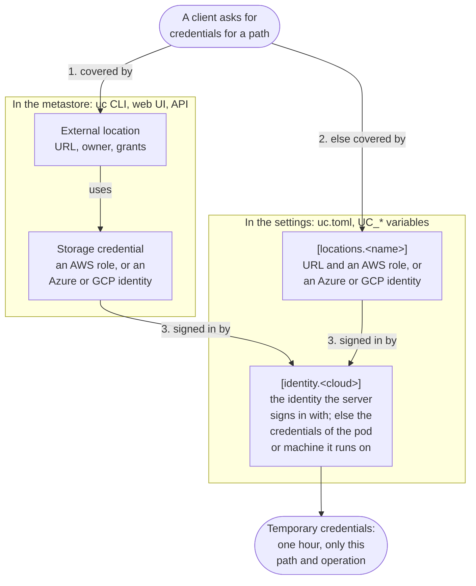

# Cloud storage

The data of tables, volumes and models is in your storage: S3, Azure Data Lake Storage (ADLS),
Google Cloud Storage (GCS) or a local folder. The server gives clients temporary credentials for
it, so that clients need no keys of their own.

## Managed and external storage

- An `EXTERNAL` table or volume is at the location that you give.
- The server chooses the location of a `MANAGED` table, volume or model, under a storage root:
  the `storage_root` of its schema, else of its catalog, else `storage.tables_root` (tables) or
  `storage.models_root` (models).

```bash
uc catalog create --name main --storage_root s3://analytics/main
```

## Temporary credentials

Clients ask for credentials for one object and one operation, such as `READ` on a table. The
credentials last one hour, and allow only the object's path. The user needs the privilege of the
operation, such as `SELECT` for `READ`.

```python
table = client.table("main.sales.orders").get()
credentials = client.generate_temporary_table_credentials(table.table_id, "READ")
```

The Delta REST API and the Iceberg REST catalog give credentials with their tables.

## Identities and locations

| Part | Its job | Who sets it |
| --- | --- | --- |
| `[identity.<cloud>]` | How the server signs in to AWS, Azure or GCP. When it is not set, the server uses the credentials of the machine or pod where it runs. | The admin, in the [settings](../reference/settings.md#identityaws) |
| External location | A URL and the identity that reaches it, with an owner and grants. | Users, with `uc external_location create`, the web UI or the API |
| `[locations.<name>]` | A URL and the identity that reaches it, without an owner or grants. | The admin, in the [settings](../reference/settings.md#locationsname) |

For a path, the server takes the identity of the external location that covers the path, else of
the `[locations.<name>]` that covers it; of several, the longest URL wins. Then it signs in with
`[identity.<cloud>]` and gets credentials of that identity. Local paths get empty credentials.



### Which location serves a path

- **A path that a user wrote**, such as the location of an external table or the `storage_root`
  of a catalog: with authorization on, it must be under an external location, so that the server
  can check the user's privileges on it.
- **A path that the admin wrote** in the settings, `storage.tables_root` and
  `storage.models_root`: a `[locations.<name>]` can serve it, and so can an external location.

With authorization off, a `[locations.<name>]` can serve any path.

For example, a catalog made with `--storage_root s3://sales/data` needs an external location on
`s3://sales`. A catalog without a storage root puts its managed tables under `tables_root`, which a
`[locations.<name>]` can serve.

## Per cloud

Each tab sets up a bucket or container in two ways: as an external location with the CLI, and in
the settings, with the server's identity, a location that uses it (`true`), a location with an
identity of its own, and the managed roots.

=== "AWS S3"

    The server's identity assumes an IAM role, with a session policy for the path and the
    operation.

    With an external location:

    ```bash
    uc credential create --name analytics \
      --aws_iam_role_arn arn:aws:iam::123456789012:role/uc-analytics
    uc external_location create --name analytics \
      --url s3://analytics/data --credential_name analytics
    ```

    In the settings:

    ```toml
    # The identity that the server signs in to AWS with. No keys are set, so
    # the server uses the IAM role of its pod (IRSA); arn names that role.
    [identity.aws]
    region = "eu-west-1"
    arn = "arn:aws:iam::111111111111:role/uc-server"

    # A bucket of the server's own account: the server assumes its own role.
    [locations.lake]
    url = "s3://acme-lake"
    aws_iam_role_arn = true

    # A bucket of another account: a role there, which trusts the server's role.
    [locations.partner]
    url = "s3://partner-data"
    region = "us-east-1"
    aws_iam_role_arn = "arn:aws:iam::222222222222:role/uc-partner"

    # Where managed tables and models go when their catalog and schema have no
    # storage root: here in the bucket of [locations.lake].
    [storage]
    tables_root = "s3://acme-lake/managed/tables"
    models_root = "s3://acme-lake/managed/models"
    ```

    - The role must trust the server's identity. The role of a storage credential must also
      require its `external_id`, which `uc credential create` shows.
    - `aws_iam_role_arn = true` assumes the server's own role, `identity.aws.arn`. Its trust
      policy must allow the role itself.
    - Storage credentials show `identity.aws.arn` as `unity_catalog_iam_arn`.
    - For an S3-compatible store, such as MinIO or RustFS, set `identity.aws.endpoint`.
    - The server does not read AWS profiles in `~/.aws`.

=== "Azure Data Lake Storage"

    The server signs in to Microsoft Entra ID, gets a user delegation key, and signs a SAS for the
    path. The identity that signs in needs a data role on the storage account, such as Storage
    Blob Data Contributor.

    With an external location:

    ```bash
    uc credential create --name lake --azure_directory_id <tenant id> \
      --azure_application_id <client id> --azure_client_secret <client secret>
    uc external_location create --name lake \
      --url abfss://data@mylake.dfs.core.windows.net/lake --credential_name lake
    ```

    In the settings:

    ```toml
    # The identity that the server signs in to Azure with: a user-assigned
    # managed identity of its VM. When it is not set, the server uses the
    # credentials of the machine or pod where it runs, such as AKS workload
    # identity.
    [identity.azure]
    managed_identity_id = "/subscriptions/<subscription>/resourceGroups/uc/providers/Microsoft.ManagedIdentity/userAssignedIdentities/uc-server"

    # A container that the server's own identity can reach (Storage Blob Data
    # Contributor on the storage account).
    [locations.lake]
    url = "abfss://lake@acmelake.dfs.core.windows.net"
    azure_managed_identity = true

    # A container in another storage account: a service principal of its own.
    [locations.partner]
    url = "abfss://data@partnerdata.dfs.core.windows.net"
    azure_directory_id = "<tenant id>"
    azure_application_id = "<client id>"
    azure_client_secret = "<client secret>"

    # Where managed tables and models go when their catalog and schema have no
    # storage root: here in the container of [locations.lake].
    [storage]
    tables_root = "abfss://lake@acmelake.dfs.core.windows.net/managed/tables"
    models_root = "abfss://lake@acmelake.dfs.core.windows.net/managed/models"
    ```

    - A service principal signs in with its secret. The server keeps the secret in its database.
      No answer of the API shows it, but backups contain it.
    - `azure_managed_identity = true`, or `--azure_managed_identity` without a value, is the
      server's own identity. With a resource ID, the server uses that user-assigned identity of
      its VM.
    - On AKS, give the server's pod workload identity with the Helm chart's
      `serviceAccount.annotations` (`azure.workload.identity/client-id`) and
      `server.deployment.extraPodLabels` (`azure.workload.identity/use: "true"`).

=== "Google Cloud Storage"

    The server gets a token of a GCP identity, and Google STS limits the token to the path and the
    operation. That identity needs the Storage Object Admin role on the bucket.

    With an external location:

    ```bash
    uc credential create --name models \
      --gcp_service_account unity-catalog@my-project.iam.gserviceaccount.com
    uc external_location create --name models \
      --url gs://models/registry --credential_name models
    ```

    In the settings:

    ```toml
    # The identity that the server signs in to GCP with: a service account key.
    # When it is not set, the server uses the credentials of the machine or
    # pod where it runs, such as GKE Workload Identity.
    [identity.gcp]
    json_key_file = "/etc/uc/gcp/uc-server.json"

    # A bucket that the server's own service account can reach.
    [locations.lake]
    url = "gs://acme-lake"
    gcp_service_account = true

    # A bucket of another project: its service account, which the server's
    # account impersonates (Service Account Token Creator on that account).
    [locations.partner]
    url = "gs://partner-data"
    gcp_service_account = "uc-partner@partner-project.iam.gserviceaccount.com"

    # Where managed tables and models go when their catalog and schema have no
    # storage root: here in the bucket of [locations.lake].
    [storage]
    tables_root = "gs://acme-lake/managed/tables"
    models_root = "gs://acme-lake/managed/models"
    ```

    - With an email, the server's identity impersonates that service account, and needs the
      Service Account Token Creator role on it. `true`, or `--gcp_service_account` without an
      email, is the server's own identity.
    - With a service account key, the server keeps the key in its database. No answer of the API
      shows it, but backups contain it.
    - On GKE, give the server's pod Workload Identity with the Helm chart's
      `serviceAccount.annotations` (`iam.gke.io/gcp-service-account`).

## Dropped data

When you delete a managed object, the server deletes its files 7 days later
(`storage.cleanup_initial_delay`).
