# Web UI

The web UI shows the catalogs of a server, and creates, edits and deletes
them and what they hold. It is a Leptos port of upstream's new console: a
dark header, the catalog tree on the left, and a page with Overview,
Details and Permissions tabs. It adds grants, temporary credentials,
column comments and a page for your access tokens. `uc-server` serves it
at `/`, on the API's origin.

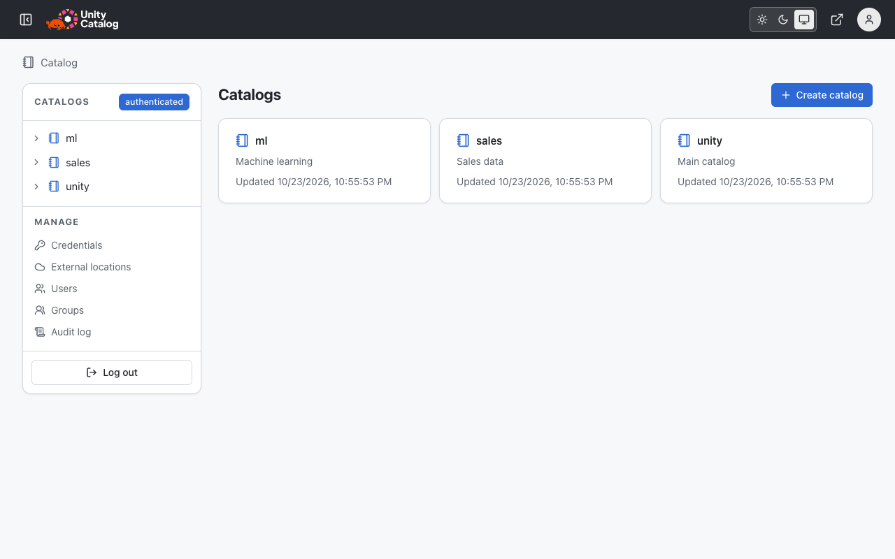

## Start the UI

- `uc dev` runs a server on `http://localhost:8080`, with the UI.
- The [image](docker.md) and the [Helm chart](kubernetes.md) serve the UI
  at `/`. `ui.enabled = false` (`UC_UI_ENABLED=false`, or `ui.enabled:
  false` in the chart) turns it off.
- A server that you start yourself serves the UI that `pip install
  'unitycatalog-rs[ui]'` installed, or the folder of `ui.dir`
  (`UC_UI_DIR`).
- `uc web` serves the UI on `http://localhost:3000` and sends its API calls
  on to another server (`--server`). The calls carry the token of the `uc`
  commands. The API docs come from that server too.

When the server needs a sign-in, the UI shows its login page first. The
"Sign in" button goes to the server's identity provider, or the page tells
you to open the UI through the auth proxy.
[Sign-in and authorization](server/auth.md#sign-in-to-the-web-ui) tells how
to set up the sign-in.

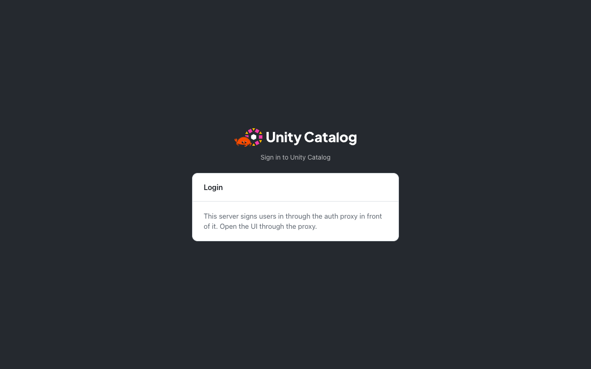

## Find your way

- The header: the first button hides and shows the tree. The logo goes to
  the list of catalogs. The three buttons at the right choose the light
  theme, the dark theme, or the system's; the UI keeps your choice in the
  browser. The arrow opens the server's REST API in Swagger UI (`/docs`),
  in a new tab. The avatar, after a sign-in, shows your name and email,
  "Access tokens" and "Log out". If the server is set up for it, "Log out"
  also signs you out of the identity provider.
- "Catalogs", on the left: the tree of the catalogs, their schemas, and
  under each schema its tables, volumes, functions and models, with their
  counts. A click on the arrow opens a node; a click on a name opens its
  page. The page that shows is selected in the tree, and its nodes are
  open. The arrow keys move between the names; the right arrow opens a
  node, and the left arrow closes it.
- Each page has a path at the top, such as "Catalog > unity > default".
  Click a part of it to go back up. Beside the name are its type badges
  and a button that loads the object again. The page's actions are at the
  right: "Edit", "Create …" or "New", and "Delete". "Delete" shows only to
  the owner of the object and to admins.
- Each page has three tabs. **Overview** has the description, with
  "Edit", and what the object holds. **Details** has the fields of the
  object, its properties, and the JSON that the server sent. **Permissions**
  has the grants, and for tables and volumes the temporary credentials.
- A page shows the data that the UI has at once, and loads it again each
  time it opens. When you come back to the window, the page loads again
  too. So a change that you make elsewhere, such as a token that you make
  with `uc`, shows without a reload of the page.

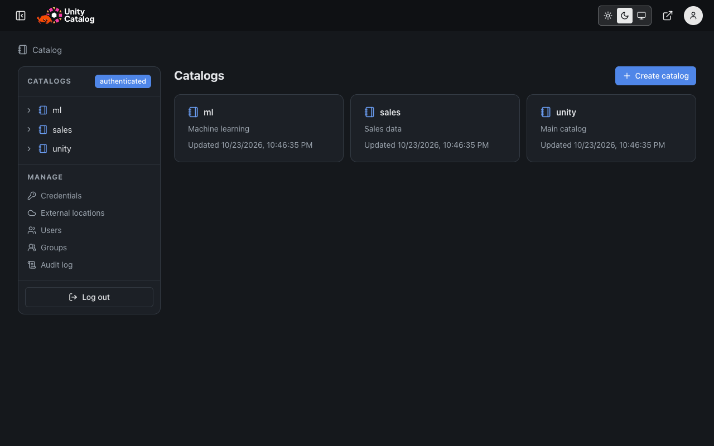

## Catalogs

1. Click the logo to see the catalogs. Click a card to open the catalog.
2. To make a catalog, click **Create catalog**. Give the name, a comment if
   you want one, and a storage root for its managed tables and volumes.
   Then click **Create**: the catalog joins the list.

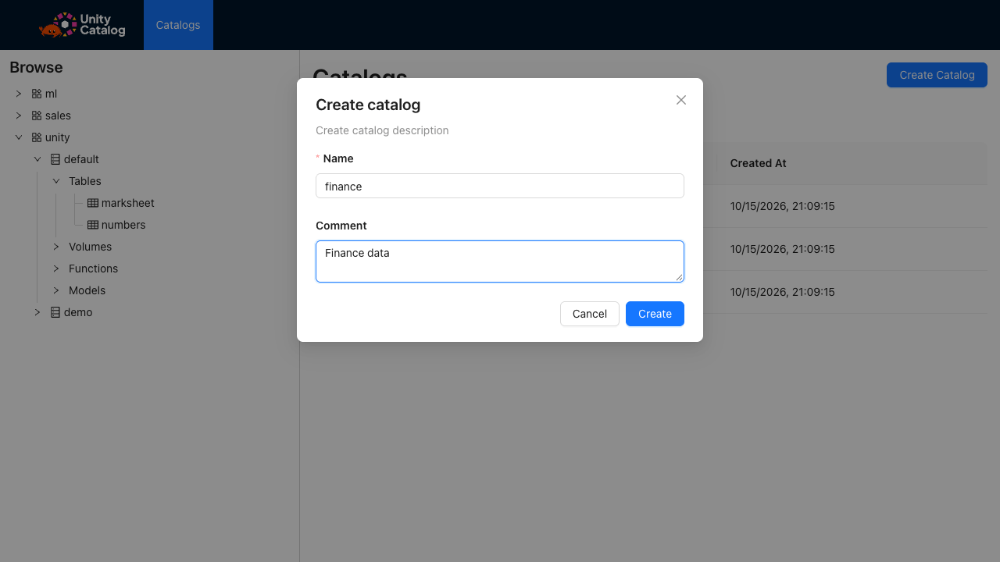

3. A catalog's page lists its schemas. **Edit** changes its name and its
   comment.

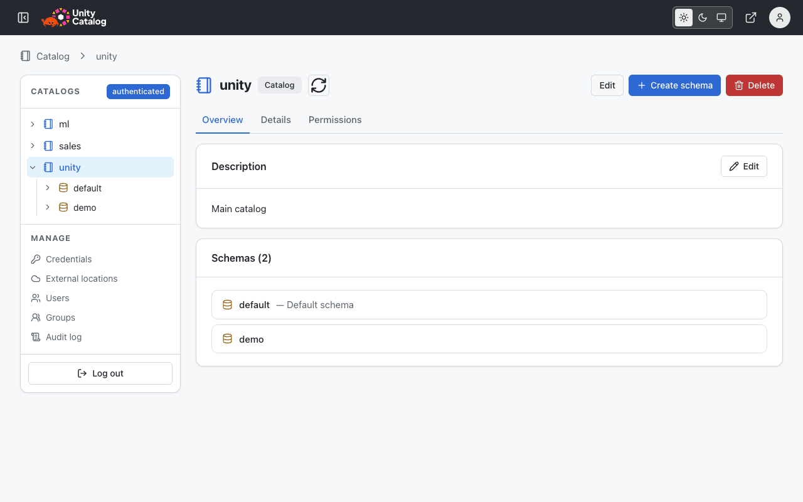

4. To delete the catalog, click **Delete**, type the catalog's name to
   confirm, and click **Delete permanently**. The server deletes only a
   catalog without schemas. An admin can tick **Also delete its schemas,
   …**: the dialog then counts what goes with the catalog, and **Delete
   permanently** asks again, in a second dialog, before **Delete
   everything**.

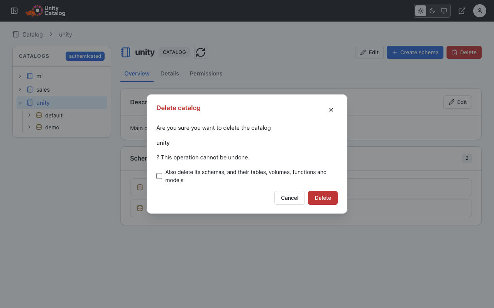

## Schemas

1. To make a schema, open its catalog and click **Create schema**.

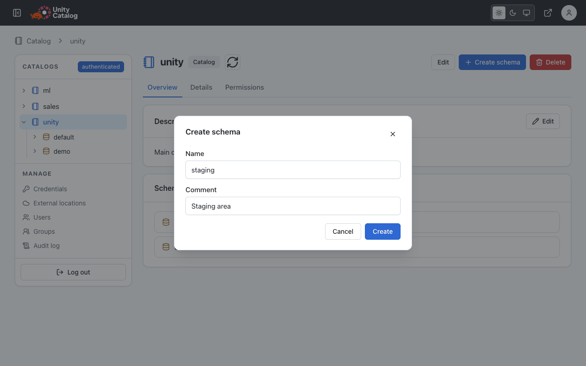

2. A schema's page lists its tables. The buttons above the list show its
   volumes, functions and models. The tree's "Tables", "Volumes",
   "Functions" and "Models" open the same lists.

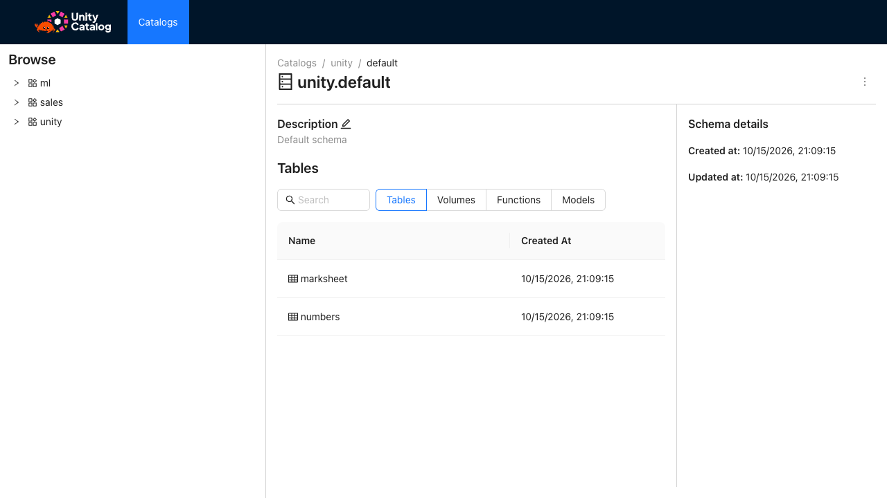

3. **New** makes an object in the schema: a table, a volume, a SQL
   function, or a registered model. Pick the type at the top of the dialog.
   A managed table goes under the storage root of its schema, catalog or
   server; an external table needs a storage location. **Add column** adds
   columns to the table, each with a name and a scalar type.

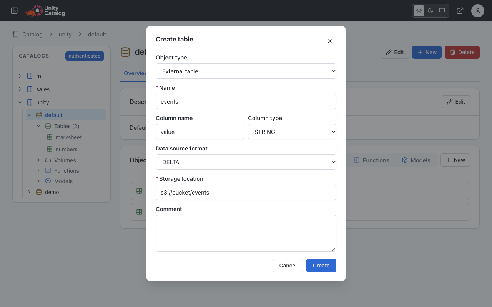

4. To delete the schema, click **Delete** and type its name to confirm.
   The server deletes only an empty schema; an admin can tick **Also
   delete its tables, …**, as for catalogs.

## Tables

A table's page shows its description and its columns: their types, whether
they take nulls, and their comments. Click the pencil in a column's row to
edit its comment, and **Edit** on the description to change it. The
Details tab has the type, the format, the storage location, the properties
and the JSON of the table. To delete the table, click **Delete** and type
its name to confirm; every delete asks for the name.


The Permissions tab of a table or volume starts with **Credentials**:
**Vend READ creds** asks the server for temporary credentials for the
object's storage location, as an engine does. The card shows them, with
their expiry; secrets stay hidden until you show them, and each value has
a copy button. **Vend READ WRITE creds** asks for credentials that write
too.

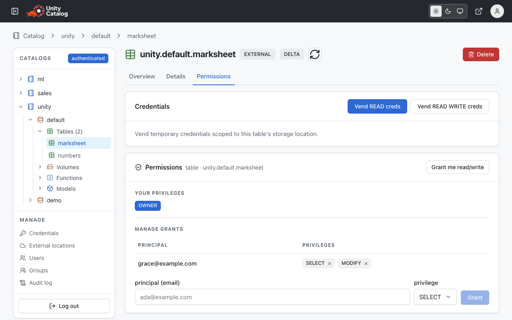

## Volumes

A volume's page shows its description, and its type and storage location
on the Details tab. **Edit** changes its name and its comment. The
Permissions tab vends credentials, as for tables.

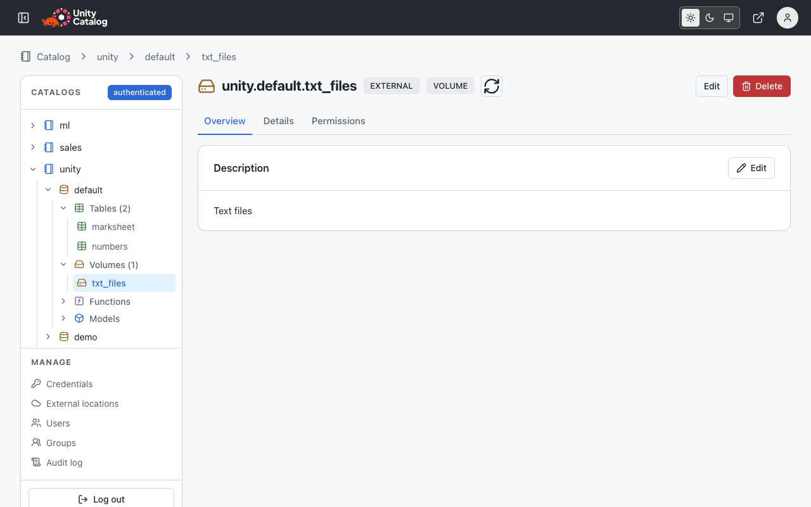

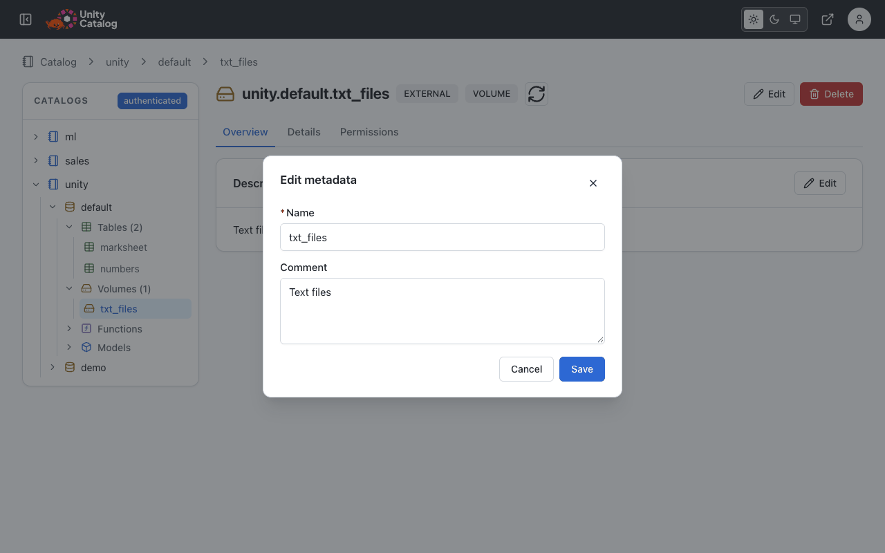

## Functions

A function's page shows its description, its parameters and its
definition. The badges name its language and its return type. To delete
the function, click **Delete**.

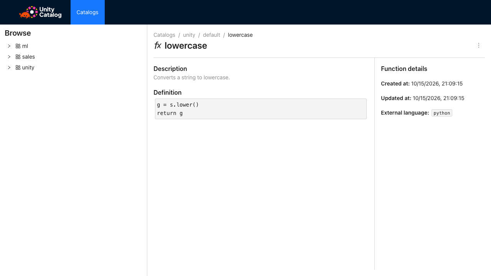

## Models

1. Open a schema and click **Models** to see its registered models.
2. To make a model, click **New** and pick **Registered model**.

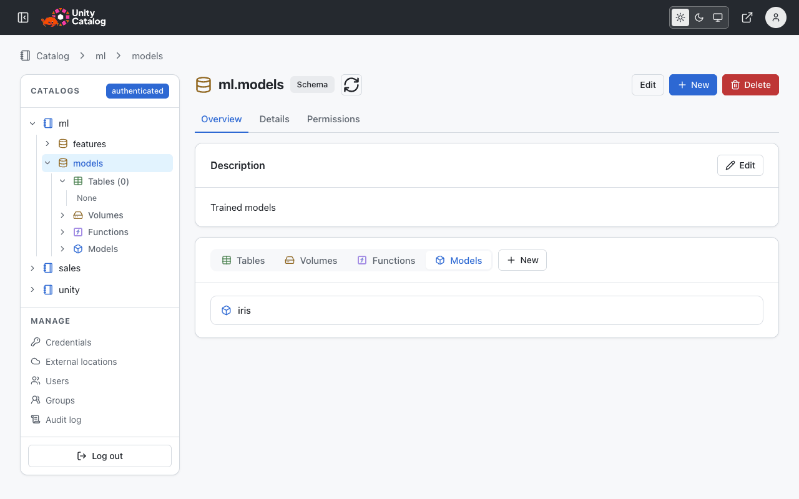

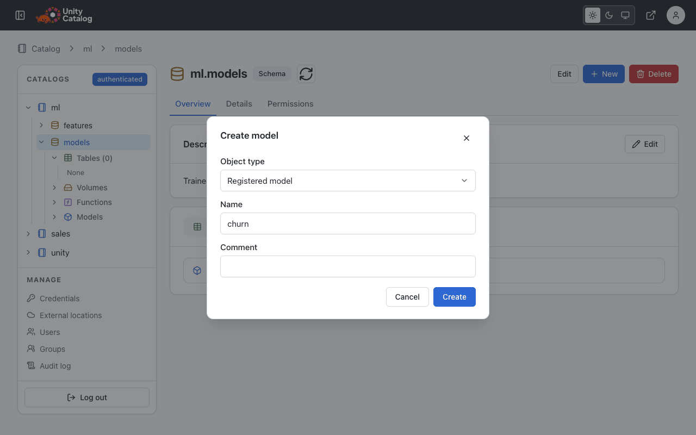

3. A model's page shows its description and its versions, with their
   status and time. **Create version** registers a version from a source
   location, with a run id if you have one.
4. To delete the model, click **Delete**. Delete its versions first, or,
   as an admin, tick **Also delete its versions**, as for catalogs.

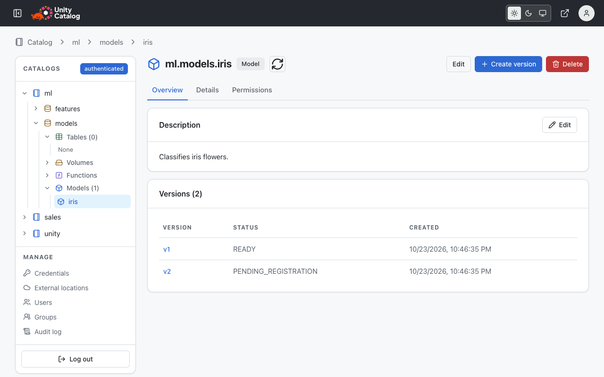

## Model versions

Click a version on the model's page. The page shows the version's
description, with **Edit**, and its details: its status, source, run id,
storage location, and when it was made and changed. A pending
version has **Finalize**, which marks it ready once its files are in
place. To delete the version, click **Delete**.

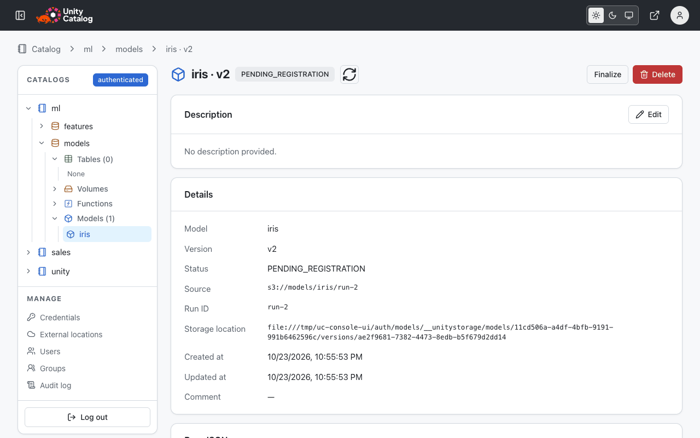

## Permissions

The Permissions tab of every object shows **Your privileges**: OWNER when
the object is yours, and the privileges granted to you. Below, **Grants**
lists every principal with privileges on the object. The server shows
every grant to the owner of the object, of its schema or of its catalog,
and to admins; other users see their own.

The owner and the admins also get **Manage grants**: type a user's email,
pick a privilege, and click **Grant**. The × after a privilege revokes it.
The privileges on offer are the ones that the kind of object can hold,
such as SELECT and MODIFY on a table. **Grant me …**, at the top of the
card, grants you the privileges that use the object: read/write on a
table, EXECUTE on a function or model. [Authorization](server/auth.md)
tells what each privilege allows.

## Access tokens

An access token lets a script or a tool call the API as you, without a
sign-in. It sends the token in the header `Authorization: Bearer <token>`;
`uc` takes it with `--auth_token`.

1. Click the avatar, then **Access tokens**. The list shows your tokens:
   the name, the first characters, and when each one was made and expires.
   An expired token shows in red.
2. To make a token, click **Create token**. Give a name, and choose when
   the token expires: in 7, 30 or 90 days, at the end of a date that you
   choose (**Custom**), or **Never**. Then click **Create**.

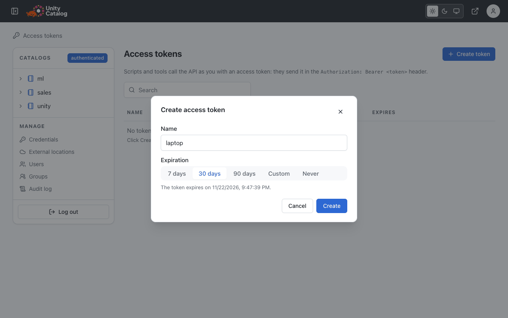

3. The new token shows above the list. Click **Copy**, and keep the token in
   a safe place. The server keeps only a hash of the token, so the page
   cannot show it again after you leave the page.


4. To stop a token, click **Delete** in its row. Scripts and tools that use
   the token can then no longer call the API.

Tokens belong to a signed-in user: without a sign-in, the page has no
tokens. The [terminal UI](cli/index.md#the-terminal-ui) has the same on its
Tokens tab.

## Upstream's React UI

The server keeps upstream's REST API, so upstream's older React UI works
against it too. Its development server sends the API calls to
`http://localhost:8080` (`proxy` in its `package.json`), where `uc-server`
listens by default:

```bash
git clone https://github.com/unitycatalog/unitycatalog.git
cd unitycatalog/ui
bun install
bun run start
```

Open `http://localhost:3000`. A UI on another origin than the API needs
CORS: the server lets every origin call the API, unless
`server.cors_allow_origins` (`UC_SERVER_CORS_ALLOW_ORIGINS`) names the
allowed ones. Upstream's new console (`ui-new`) talks to its own Rust
bridge, not to the REST API directly; this UI is its port.
